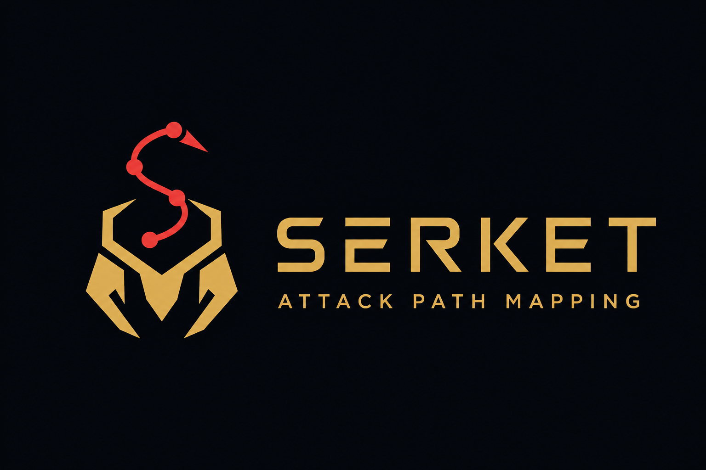
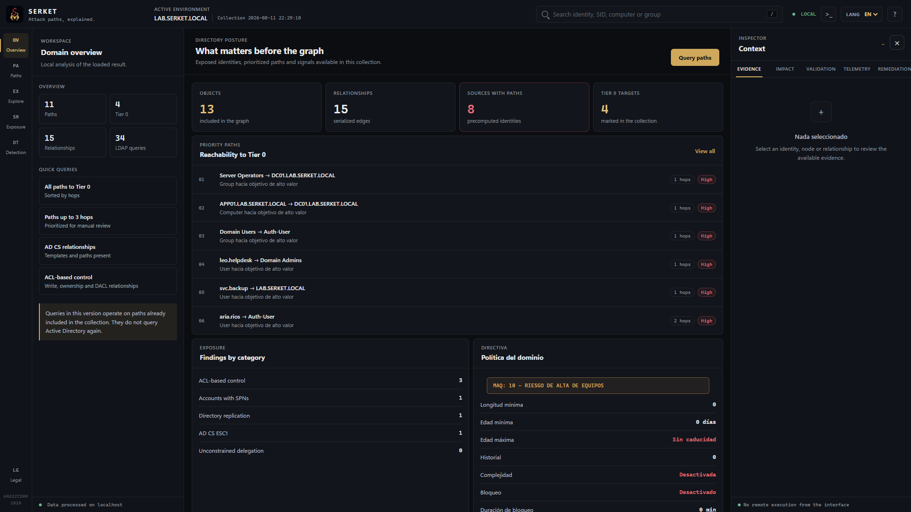
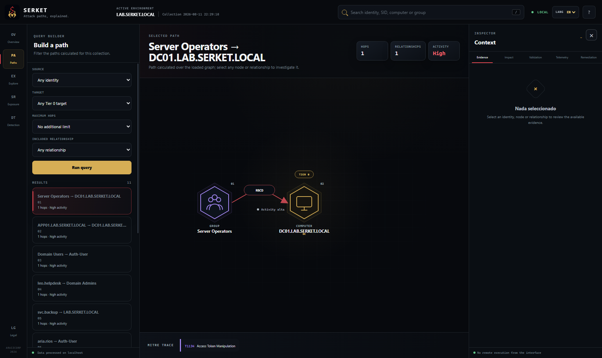
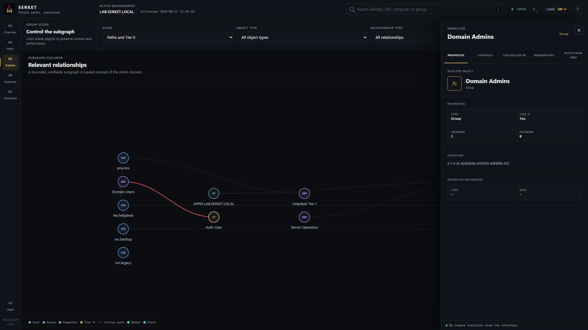
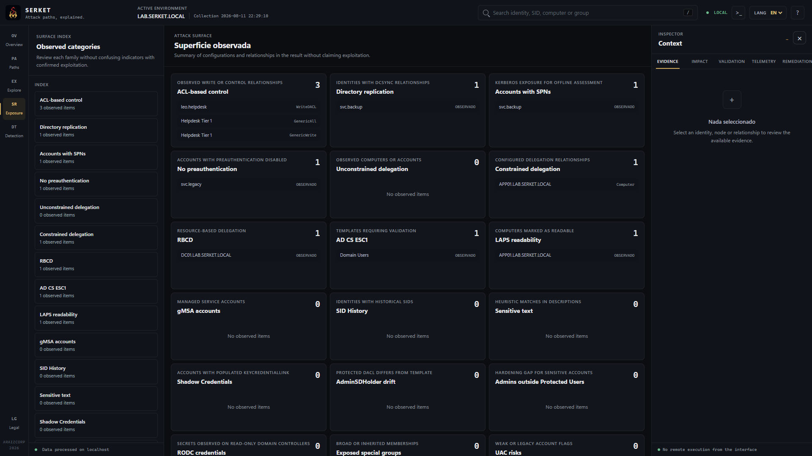
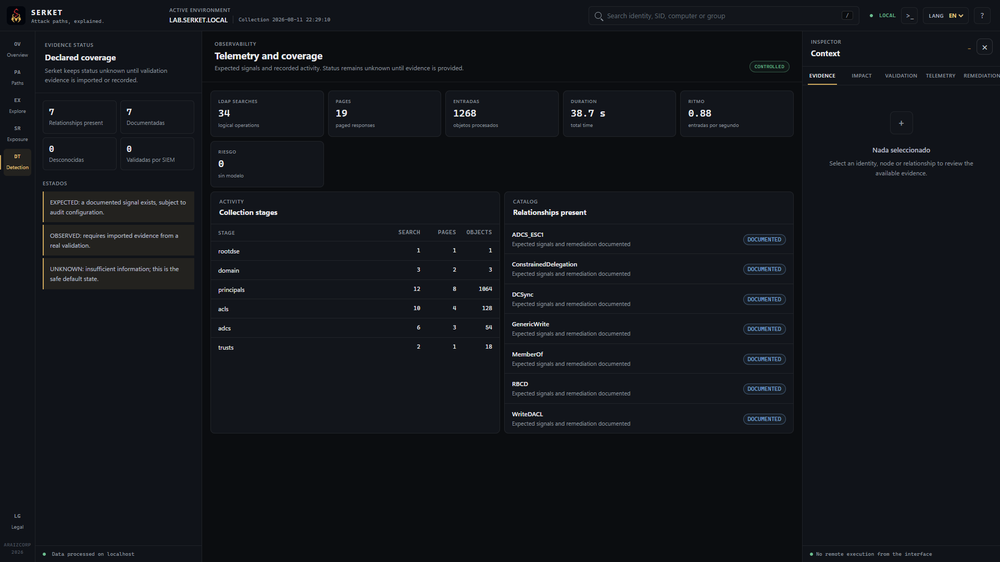
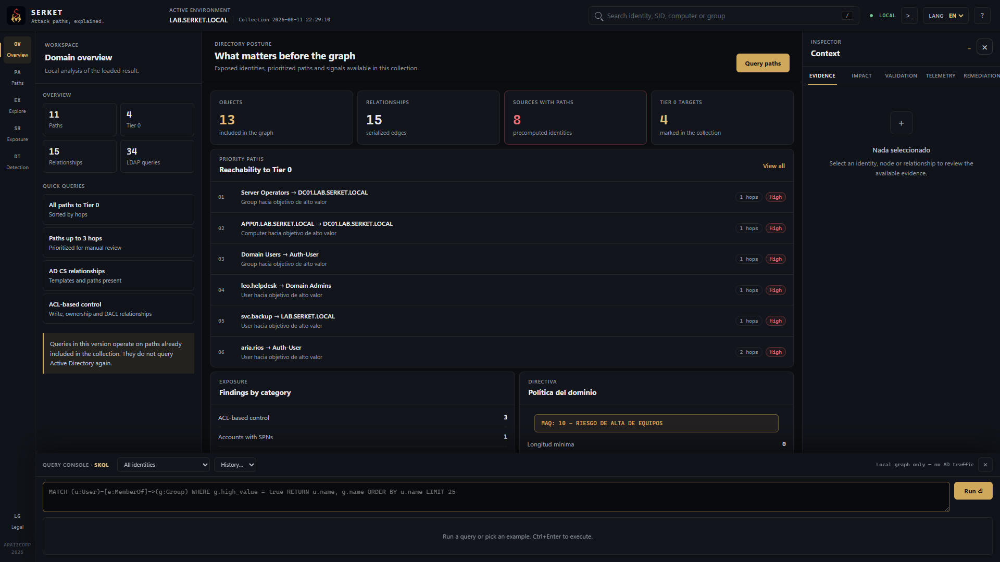
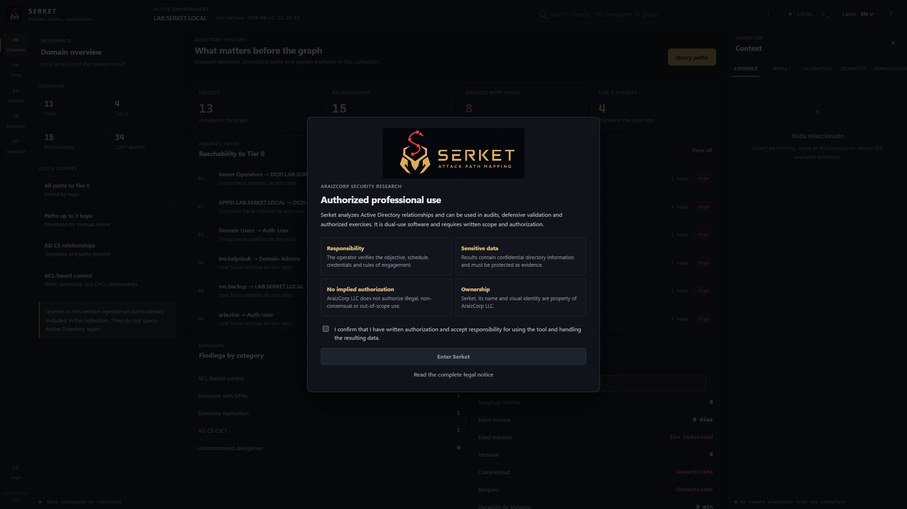
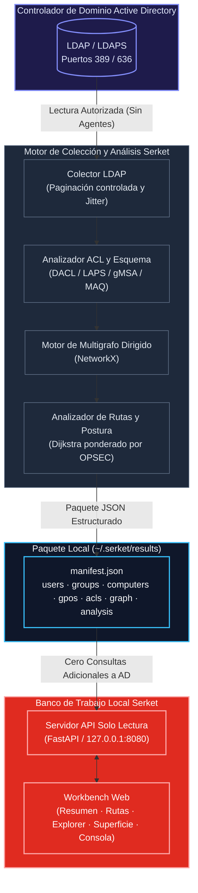

<p align="center">
  
</p>

<h1 align="center">Serket</h1>

<p align="center">
  Inteligencia de relaciones y análisis de rutas de ataque en Active Directory.<br>
  Una herramienta de seguridad de doble uso y ejecución local creada por <strong>AraizCorp LLC</strong>.
</p>

<p align="center">
  <a href="https://github.com/araizcorp/Serket/releases/tag/v2.1.0"></a>
  
  
  
  
  <a href="LICENSE"></a>
</p>

<p align="center">
  <a href="README.md">English</a> · <a href="README.es.md">Español</a> ·
  <a href="LEGAL.es.md">Aviso legal</a> · <a href="DOCKER.md">Guía de contenedores</a> ·
  <a href="https://github.com/araizcorp/Serket/releases/tag/v2.1.0"><strong>Descargar serket.exe (v2.1.0)</strong></a>
</p>

> [!WARNING]
> **Estado de desarrollo:** Serket es actualmente una versión preliminar en desarrollo activo. La colección principal, construcción del grafo, análisis de resultados, buscador universal y exploración interactiva de rutas funcionan, pero la cobertura todavía no es completa. No debe utilizarse como única base para una decisión de seguridad en producción.

> [!TIP]
> **Ejecutable independiente para Windows disponible:** Puedes descargar `serket.exe` directamente desde [Release v2.1.0](https://github.com/araizcorp/Serket/releases/tag/v2.1.0) sin necesidad de tener Python instalado ni configurar entornos virtuales en la máquina operadora.

Serket recopila metadatos autorizados de Active Directory mediante LDAP, transforma identidades y permisos en un grafo dirigido y muestra el resultado en un banco de trabajo de investigación propio. Está pensado para defensores, auditores y equipos red/purple que trabajen con autorización expresa y reglas de enfrentamiento definidas.

Serket no se presenta como “indetectable”. Su perfil de colección controlada reduce consultas innecesarias, mide la huella de la colección y permite comparar la actividad esperada con la telemetría del DC, SIEM, EDR y NDR.

---

### Interfaz Visual del Workbench



| Rutas de ataque (ponderación OPSEC) | Explorador de subgrafos e inspector |
|:---:|:---:|
|  |  |

| Superficie de ataque observada | Telemetría e ingeniería de cobertura |
|:---:|:---:|
|  |  |

| Consola de consultas SKQL integrada | Pasarela de autorización |
|:---:|:---:|
|  |  |

> Capturas reales del Workbench de Serket v2.1 sirviendo el conjunto de datos `demo/` incluido.

---

## Estado de las funciones

| Función | Estado | Alcance y notas |
|:---|:---:|:---|
| **Colección LDAP/DC-only** |  | Usuarios, grupos, sistemas, directivas de dominio, jerarquía OU/contenedores, GPO, trusts, permisos de propietario+DACL y AD CS |
| **SYSVOL offline opcional** |  | Copia local o montada autorizada: Registry.pol, inventario de scripts y preferencias de usuarios/grupos locales |
| **Clasificación de sistemas** |  | Estaciones de trabajo, servidores miembro y controladores de dominio se modelan y cuentan por separado |
| **Autenticación** |  | Prompt de contraseña, hash NTLM, caché Kerberos y LDAPS opcional |
| **Rate-limit con jitter** |  | `--rate-limit` + `--jitter` aleatorizan la cadencia de paginación LDAP (±50% por defecto) |
| **Grafo de relaciones** |  | Multigrafo dirigido; conserva permisos paralelos sin sobrescribir relaciones |
| **Rutas globales** |  | Algoritmo Dijkstra con ponderación OPSEC hacia objetivos de alto valor y Tier 0 |
| **Consulta interactiva** |  | Origen hacia destino o Tier 0 sobre el grafo en memoria sin volver a consultar al controlador |
| **Buscador universal** |  | Nombre, SID, UPN, DN, DNS y `sAMAccountName` |
| **Inspector de nodos y relaciones** |  | Controla, controlado por, membresías, rutas, evidencia, impacto y remediación |
| **Workbench web local** |  | Vistas Resumen, Rutas, Explorer, Superficie y Detección; inglés por defecto, español seleccionable |
| **Empaquetado Docker** |  | Imagen endurecida sin privilegios, Docker Compose y publicación GHCR multi-arquitectura |
| **Clasificación AD CS** |  | Detección automatizada de plantillas vulnerables ESC1 |
| **Análisis de Trusts** |  | Enumeración de relaciones de confianza; inferencias de abuso avanzado planificadas |
| **Validación de detección** |  | Guía y telemetría esperada; importación en vivo de evidencia SIEM/EDR en desarrollo |
| **Paquete de colección** |  | Manifiesto con archivos JSON modulares para identidades, sistemas, permisos, estructura, grafo y análisis |

---

## Arquitectura y funcionamiento



La interfaz web lee exclusivamente el resultado almacenado en disco. Nunca ejecuta comandos de validación en los equipos y una consulta interactiva de rutas jamás vuelve a conectarse al directorio.

---

## Colección controlada (OPSEC)

Serket está diseñado para trabajos autorizados de red team y purple team en los que la propia recopilación debe mantener un perfil bajo:

- **Solo LDAP, solo DC, sesión única.** Sin SMB, sin Kerberoasting, sin escaneo de puertos. El único tráfico son búsquedas LDAP paginadas estándar contra un único controlador de dominio.
- **Paginación con rate-limit y jitter aleatorio.** `--rate-limit SEC` (`0.08` por defecto) pausa entre páginas; `--jitter 0-1` (`0.5` por defecto) aleatoriza cada pausa en ±50% para que la cadencia no parezca la de un script regular. Sube ambos valores para un perfil más lento y silencioso (p. ej. `--rate-limit 0.4 --jitter 0.7`).
- **LDAPS** (`--ldaps`) cifra las consultas en tránsito en el puerto 636.
- **Medición de huella.** Cada ejecución registra las búsquedas, páginas y entradas generadas (`collection.telemetry` en el manifiesto) para comparar la actividad esperada con la telemetría del DC, SIEM, EDR y NDR durante la revisión purple team.

Serket no afirma ser indetectable: con auditoría de consultas LDAP activada, cualquier cliente LDAP es observable. El objetivo es un perfil controlado y medible, no la invisibilidad.

---

## Requisitos del sistema

- Python 3.10 o posterior
- Acceso de red desde el equipo recolector hacia el controlador de dominio autorizado
- Cuenta de dominio con permisos de lectura suficientes para el alcance seleccionado
- Docker o Podman únicamente si se utiliza el flujo de contenedores

> [!NOTE]
> La visibilidad de ACL, LAPS, gMSA y AD CS depende de los permisos asignados a la cuenta de auditoría y de la configuración del entorno analizado.

---

## Prueba rápida con datos sintéticos

El laboratorio incluido contiene identidades ficticias de `LAB.SERKET.LOCAL` y no se conecta a ningún controlador de dominio.

### Windows PowerShell

```powershell
py -m venv .venv
.\.venv\Scripts\Activate.ps1
python -m pip install .
serket --serve demo/serket-demo.json
```

### Linux o macOS

```bash
python3 -m venv .venv
source .venv/bin/activate
python -m pip install .
serket --serve demo/serket-demo.json
```

Abre <http://127.0.0.1:8080>. El modo nativo escucha únicamente en loopback y habitualmente abre el navegador por defecto de forma automática.

---

## Instalación para colección nativa

Serket requiere Python 3.10 o posterior. La instalación crea el comando `serket`; no ejecutes la herramienta con `python serket.py` tras instalarla.

### Kali Linux, Linux y macOS

```bash
git clone https://github.com/araizcorp/Serket.git
cd Serket
python3 -m venv .venv
source .venv/bin/activate
python -m pip install --upgrade pip
python -m pip install .
hash -r
serket --help
```

En Kali o cualquier otra distribución Linux, **no utilices `py -m pip install .`**. `py` es el lanzador de Python de Windows y en Linux puede apuntar a otro binario. Con el entorno virtual activo, utiliza `python -m pip install .` como se indica arriba.

El comando `serket` funciona desde cualquier directorio mientras el entorno virtual esté activo. Para utilizarlo en otra terminal:

```bash
source /ruta/a/Serket/.venv/bin/activate
serket --help
```

<details>
<summary><strong>Alternativa: Instalación global con pipx</strong></summary>

Si tienes `pipx` instalado y quieres disponer de `serket` en el `PATH` sin tener que activar el entorno virtual manualmente:

```bash
pipx install .
pipx ensurepath
```

Abre una terminal nueva y verifica el comando con `serket --help`.
</details>

### Windows PowerShell

```powershell
git clone https://github.com/araizcorp/Serket.git
Set-Location Serket
py -m venv .venv
.\.venv\Scripts\Activate.ps1
python -m pip install --upgrade pip
python -m pip install .
serket --help
```

`py` se utiliza únicamente para crear el entorno en Windows. Si el lanzador no está disponible, sustitúyelo por `python`. Tras activarlo, usa `python -m pip` para instalar el comando en el entorno activo.

---

## Recopilar un dominio autorizado

### Autenticación con contraseña

Omite `-p` para introducir la credencial mediante el prompt oculto sin dejar rastro en el historial del shell:

```bash
serket \
  -d corp.local \
  -u auditor \
  --ldaps
```

Serket descubre automáticamente un controlador mediante los registros DNS SRV de Active Directory del dominio. Usa `-dc HOST` únicamente para anular el descubrimiento, seleccionar un controlador concreto o solventar la falta de DNS de AD.

### Autenticación con Kerberos

```bash
export KRB5CCNAME=/tmp/auditor.ccache
serket -d corp.local -u auditor -k
```

Equivalente en PowerShell:

```powershell
$env:KRB5CCNAME = "C:\ruta\hacia\auditor.ccache"
serket -d corp.local -u auditor -k
```

### Autenticación con hash NTLM

```bash
serket \
  -d corp.local \
  -u auditor \
  --hashes :NT_HASH
```

> [!IMPORTANT]
> Utiliza exclusivamente credenciales expresamente autorizadas para el ejercicio. Prioriza siempre LDAPS si el entorno lo soporta.

<details>
<summary><strong>Avanzado: Evidencia SYSVOL offline opcional</strong></summary>

Proporciona una copia local o montada expresamente autorizada de SYSVOL para auditar directivas sin alterar el límite estricto de solo LDAP:

```bash
serket -d corp.local -u auditor -k --sysvol-root /evidencia/SYSVOL
```

Serket no descubre ni monta recursos compartidos en red. El análisis de directivas del registro está acotado, los scripts se representan únicamente mediante hashes y los valores `cpassword` de GPP jamás se almacenan. Sin `--sysvol-root`, SYSVOL figura como `not_assessed` en vez de asumirse seguro.
</details>

<details>
<summary><strong>Avanzado: Integración con superficie externa Portico</strong></summary>

Portico permanece como una herramienta independiente para que el sensor expuesto a Internet no requiera acceso LDAP y el host de Serket no necesite salida a Internet. Para importar un puente sanitizado:

```bash
serket external-enrich --input assessment.serket \
  --bridge portico-bridge.json --output assessment-external.serket
```

Para una ejecución combinada autorizada con el ejecutable `portico` instalado en el `PATH`:

```bash
serket -d corp.local -u auditor -k --include-external-surface
```

Este modo invoca `portico scan` y `portico export` como procesos secundarios independientes, consume el bridge libre de secretos y continúa limpiamente si Portico no estuviera disponible. Serket nunca realiza sondeos a Internet de forma predeterminada.
</details>

---

### Controles de recopilación

```bash
serket \
  -d corp.local \
  -u auditor \
  --rate-limit 0.20 \
  --max-paths 50 \
  --no-adcs
```

| Opción / Flag | Tipo | Defecto | Descripción |
|:---|:---:|:---:|:---|
| `-dc HOST` | `string` | Auto-SRV | Anula el descubrimiento DNS automático y fija un controlador específico |
| `--rate-limit SEC` | `float` | `0.08` | Intervalo de espera entre páginas LDAP (en segundos) |
| `--jitter FLOAT` | `float` | `0.50` | Porcentaje de varianza aleatoria aplicada a la pausa de paginación (±50%) |
| `--max-paths N` | `int` | `20` | Número máximo de rutas globales precálculadas y almacenadas |
| `--no-acls` | `flag` | `False` | Omite la lectura de propietario y DACL; acelera la ejecución pero descarta relaciones clave |
| `--no-adcs` | `flag` | `False` | Omite la enumeración de plantillas de certificados y jerarquía de emisión |
| `--include-external-surface` | `flag` | `False` | Ejecuta Portico como subproceso e integra su bridge sanitizado |
| `--ldaps` | `flag` | `False` | Fuerza conexión LDAP sobre TLS en el puerto 636 |
| `-o DIR` | `path` | `~/.serket/` | Directorio de destino para el paquete de resultados |
| `--quiet` | `flag` | `False` | Suprime barras de progreso interactivas para ejecuciones automatizadas |

Las consultas de descriptores de ACL y ADCS solicitan automáticamente propietario y DACL mediante el control LDAP de descriptores de seguridad de Microsoft. No requieren ninguna opción ni dependencia adicional. `--no-acls` y `--no-adcs` se aplican directamente a la recolección; no son simples filtros visuales.

### Cobertura: LDAP/DC-only frente a datos de hosts

La ejecución estándar de Serket es una recopilación LDAP/DC-only. Cubre la estructura del directorio equivalente a un colector estilo BloodHound: propiedades de objetos, membresías de grupos, trusts, estructura de OU/contenedores, enlaces de GPO, permisos de propietario/DACL sobre usuarios, grupos, equipos, GPO, OU, contenedores y dominio, además de los objetos AD CS soportados.

No contacta individualmente con los equipos del dominio. Por tanto, no infiere relaciones basadas en host como `HasSession`, `AdminTo` local, `CanRDP`, `ExecuteDCOM`, `CanPSRemote` o `SQLAdmin`. Esas relaciones requieren SMB/RPC, registro o telemetría de endpoint y otro nivel de ruido/autorización. Cada resultado registra esta diferencia en `coverage` para evitar falsas asunciones de ausencia de riesgo. Esto sigue la metodología de separación entre DC y equipos de [SharpHound](https://bloodhound.specterops.io/collect-data/ce-collection/sharphound-flags).

---

## Resultados y estructura del paquete

Por defecto, Serket genera un directorio de resultados bajo `~/.serket/results/`:

```text
serket_corp_local_YYYYMMDD_HHMMSS/
├── manifest.json
├── domain.json
├── users.json
├── groups.json
├── computers.json
├── directory_objects.json
├── gpos.json
├── trusts.json
├── permissions.json
├── adcs.json
├── summary.json
├── graph.json
├── analysis.json
└── report.txt
```

`manifest.json` declara el esquema del paquete y sus archivos modulares. Esta partición permite verificar la integridad de cada fase y validar el paquete antes de cargarlo en memoria. El motor de grafo y rutas opera sobre la totalidad del conjunto lógico. Trata este directorio como evidencia sensible de auditoría; no muevas componentes aislados.

`serket server`, `--load` y `--serve` aceptan indistintamente la carpeta de la colección o su `manifest.json`. Los archivos JSON individuales de versiones previas continúan siendo compatibles.

Los resultados generados con la versión v2.0 inicial afectada, en la que los SID binarios se exportaron como cadenas ilegibles, son reparados automáticamente en memoria al cargarse. Esto restablece identificadores canónicos, clasificación de equipos, marcado de Tier 0 y rutas por membresía. Para obtener cobertura completa de DACL/propietario, realiza una nueva recolección.

---

### Abrir el resultado más reciente en el Workbench

Tras completar una colección, inicia la interfaz web sin buscar manualmente la carpeta:

```bash
serket server
```

Abre automáticamente la colección más reciente de `~/.serket/results/`. Para seleccionar el último análisis de un dominio específico:

```bash
serket server -d corp.local
```

Usa `--port 9090` para asignar otro puerto o `--output DIR` si guardaste la colección en otra ruta. El Workbench escucha exclusivamente en `127.0.0.1`.

### Inspeccionar un resultado en terminal

```bash
serket --load ~/.serket/results/serket_corp_local_YYYYMMDD_HHMMSS
```

### Servir un paquete específico en el Workbench

```bash
serket \
  --serve ~/.serket/results/serket_corp_local_YYYYMMDD_HHMMSS \
  --port 8080
```

---

## Uso del Workbench

1. **Resumen:** Métricas globales del dominio, recuento diferenciado de estaciones/servidores/DC, calidad de datos y rutas críticas hacia Tier 0.
2. **Buscar:** Localización universal de entidades por nombre parcial, SID, UPN, nombre distintivo (DN), DNS o `sAMAccountName`.
3. **Rutas:** Selección interactiva de nodo origen y destino específico o todo Tier 0, con filtros por tipo de relación y límite de saltos.
4. **Grafo enfocado:** Subgrafo interactivo centrado en la ruta seleccionada. Los nodos diamante se pueden reposicionar libremente; aristas, etiquetas y curvas se recalculan en tiempo real.
5. **Inspector:** Panel de detalle para cualquier nodo o arista. Pestañas de relaciones entrantes/salientes, membresías, rutas, evidencia, telemetría y guías de remediación.
6. **Explorer:** Navegación manual progresiva paso a paso. Al hacer clic en un objeto, se convierte en el foco activo mostrando sus aristas salientes. El botón **Volver** recupera el estado previo.
7. **Diseño de Explorer:** Barra horizontal compacta sobre el lienzo. El panel de detalles se abre como inspector flotante desacoplado, sin alterar nunca el tamaño ni el zoom del grafo.
8. **Superficie:** Resumen de exposición consolidado (Kerberos, delegaciones, permisos ACL, AD CS, SID history, LAPS y gMSA).
9. **Detección:** Contrapone telemetría esperada con estado de validación. El estado "Desconocido" indica ausencia de logs importados, no invulnerabilidad.

El selector `EN / ES` permite alternar el idioma de la interfaz en cualquier momento, persistiendo la preferencia en el navegador.

---

## Referencia de la API Local

El Workbench está respaldado por una API local de solo lectura pensada para respuesta ágil y scripting:

| Método | Endpoint | Descripción |
|:---:|:---|:---|
|  | `/api/search?q=query` | Búsqueda universal de nodos por nombre, SID, UPN, DN o sAMAccountName |
|  | `/api/nodes/{node_id}` | Propiedades detalladas del nodo y relaciones en ambas direcciones |
|  | `/api/graph` | Esquema normalizado del multigrafo completo |
|  | `/api/stats` | Métricas de grafo, clasificación de sistemas y calidad de datos |
|  | `/api/coverage` | Alcance recopilado del directorio frente a telemetría de host no evaluada |
|  | `/api/paths` | Rutas de ataque globales precálculadas hacia Tier 0 |
|  | `/api/query-paths` | Cálculo de rutas bajo demanda sobre el grafo cargado (sin requery a AD) |
|  | `/api/surface` | Resumen de superficie observada (Kerberos, AD CS, ACLs, LAPS, gMSA) |
|  | `/healthz` | Comprobación de estado y disponibilidad de la API local |

Cuerpo de consulta de ejemplo para `/api/query-paths`:

```json
{
  "source": "S-1-5-21-...-1101",
  "target": "tier0",
  "max_hops": 6,
  "include_edge": "all",
  "limit": 25
}
```

La respuesta declara explícitamente `"queried_directory": false` ya que el análisis se ejecuta enteramente en memoria sobre el grafo guardado.

---

## Cobertura actual de relaciones y exposición

Cuando existe evidencia suficiente, Serket modela:

- Membresías directas y transitivas de grupos (`MemberOf`)
- Contenedores, enlaces GPO (`Contains`, `GPLink`) y control administrativo sobre controladores
- Permisos estándar y extendidos (`GenericAll`, `GenericWrite`, `WriteDACL`, `WriteOwner`, `AllExtendedRights`)
- Control de identidades (`Owns`, `ForceChangePassword`, `AddMember`, `AddSelf`)
- Abuso de credenciales y atributos (`AddKeyCredentialLink`, `AddAllowedToAct`, `WriteSPN`, `WriteAccountRestrictions`)
- Derechos de replicación (`GetChanges`, `GetChangesAll`, `GetChangesInFilteredSet`) y derivación de `DCSync`
- Delegación Kerberos no restringida, restringida y basada en recursos (RBCD)
- Cuentas vulnerables a Kerberoasting y AS-REP Roasting
- Rutas de inscripción abusivas en AD CS (ESC1)
- Historial de SID (`sIDHistory`) e indicadores heurísticos de contraseñas en descripciones
- Indicadores de visibilidad para Microsoft LAPS legado y Windows LAPS moderno
- Indicadores gMSA seguros sin persistir el blob de contraseña en claro
- Confianzas de dominio (`Trust`) y metadatos relevantes de GPO

Serket conserva múltiples permisos entre un mismo origen y destino. La evidencia no transitable (como un permiso de replicación solitario) se mantiene en el inventario pero se excluye de las rutas transitables hasta que se cumplan las precondiciones de ataque.

---

## Docker

### Construcción local

```bash
docker build --tag serket:dev .
docker run --rm \
  --read-only \
  --tmpfs /tmp:rw,noexec,nosuid,size=64m \
  --cap-drop ALL \
  --security-opt no-new-privileges \
  -p 127.0.0.1:8080:8080 \
  serket:dev
```

### Docker Compose

```bash
docker compose up --build
```

### Imagen publicada

El flujo de publicación está preparado para `ghcr.io/araizcorp/serket`. La descarga pública será válida una vez publicada la versión etiquetada:

```bash
docker pull ghcr.io/araizcorp/serket:latest
```

Consulta [DOCKER.md](DOCKER.md) para más detalles sobre montajes de solo lectura y configuraciones de Compose.

---

## Seguridad y privacidad

- La escucha local se vincula de forma estricta a `127.0.0.1`.
- La interfaz no contiene dependencias de CDN, motores Neo4j externos ni analíticas telemétricas.
- Ningún dato de la recolección se transmite a servidores de AraizCorp ni a terceros.
- La API desactiva almacenamiento en caché y añade cabeceras de seguridad HTTP restrictivas.
- El Workbench es de solo lectura y nunca ejecuta comandos de validación en los sistemas evaluados.
- El colector registra auditoría de búsquedas, páginas y tiempos para revisión posterior.

Serket no sustituye la autorización expresa, el plan de colección ni la gestión de cambios. Conserva y destruye los datos de acuerdo con los acuerdos de confidencialidad del proyecto.

---

## Limitaciones y roadmap

Áreas en desarrollo activo:

- Recopilación de sesiones y derechos locales en hosts (`HasSession`, `AdminTo` local, RDP, DCOM, PSRemote, administración SQL); el colector se mantiene intencionadamente centrado en LDAP/DC
- Análisis automatizado ampliado de AD CS (ESC2–ESC8)
- Conclusiones avanzadas de trusts, filtrado de SID y aislamiento de cuarentena
- Ingesta en vivo de evidencia SIEM/EDR y estado de detección verificado
- Reanudación de colecciones interrumpidas
- Paquetes de evaluación portables `.serket` con firma de integridad
- Optimización para dominios masivos y preajustes avanzados de consulta gráfica
- Centro de exportación web a informes ejecutivos PDF, Markdown y CSV

---

## Pruebas de desarrollo y verificación

```bash
python -B -m unittest discover -s tests -v
python -m py_compile serket.py serket/cli.py serket/server/api.py
node --check serket/ui/workbench.js
node --check serket/ui/path-graph-interactions.js
docker build --tag serket:dev .
```

La suite de pruebas automatizadas valida cabeceras de API, normalización de grafos, análisis de descriptores y SID binarios, composición de DCSync, permisos paralelos, clasificación de sistemas, rutas a controladores de dominio, compatibilidad con resultados heredados, internacionalización y búsqueda universal.

---

## Estructura del repositorio

```text
pyproject.toml             Metadatos del paquete y punto de entrada `serket`
serket.py                  Wrapper de compatibilidad para ejecución directa
serket/cli.py              Lógica de línea de comandos y orquestación
serket/collector/          Recopilación LDAP y análisis de ACL
serket/graph/              Construcción del grafo y cálculo de rutas
serket/output/             Persistencia en disco y reportes en terminal
serket/server/             API local de solo lectura FastAPI
serket/ui/                 Workbench web, traducciones y recursos de marca
demo/                      Conjunto de datos sintéticos de evaluación
tests/                     Suite de pruebas de regresión automatizadas
.github/workflows/         Flujo CI de pruebas y publicación en GHCR
```

---

## Uso responsable, licencia y propiedad

Utiliza Serket únicamente en sistemas que te pertenezcan o sobre los que cuentes con autorización expresa y por escrito para realizar evaluaciones de seguridad. El operador es el único responsable del alcance, horarios, reglas de enfrentamiento, cumplimiento normativo y custodia de la información.

Copyright © 2026 **AraizCorp LLC**. El código fuente se distribuye bajo la [Licencia MIT](LICENSE). Dicha licencia no otorga derechos sobre la marca, logotipos ni identidad visual de Serket o AraizCorp. Consulta el [aviso legal completo](LEGAL.es.md) antes de su utilización.
