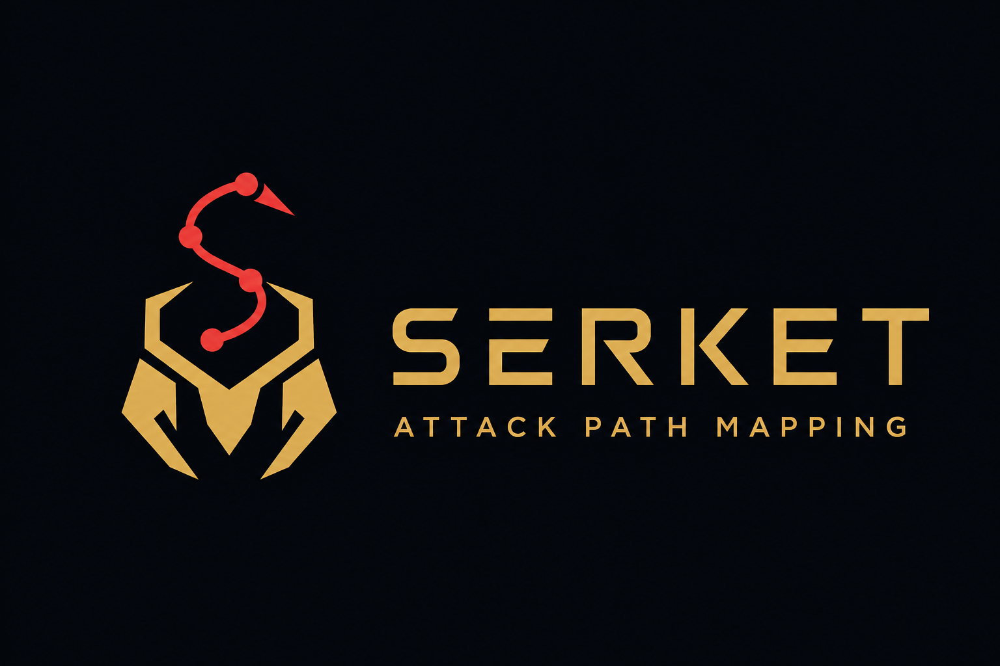
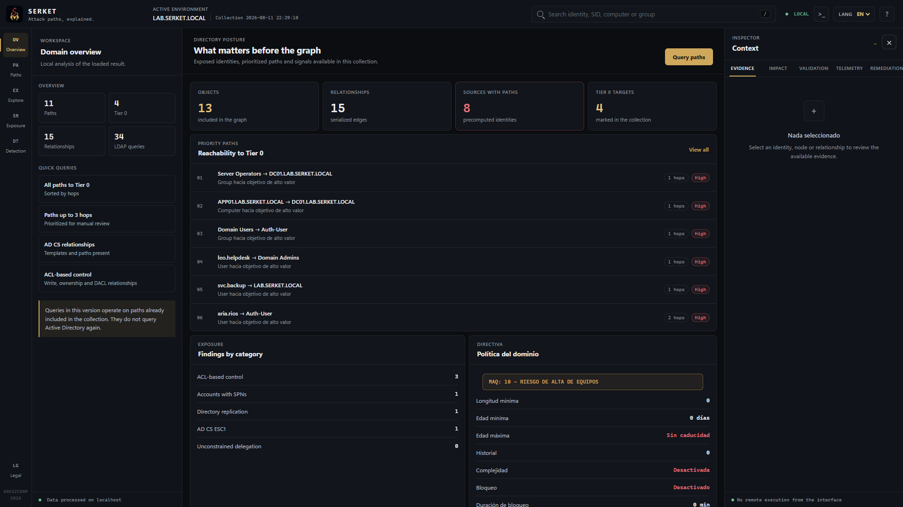
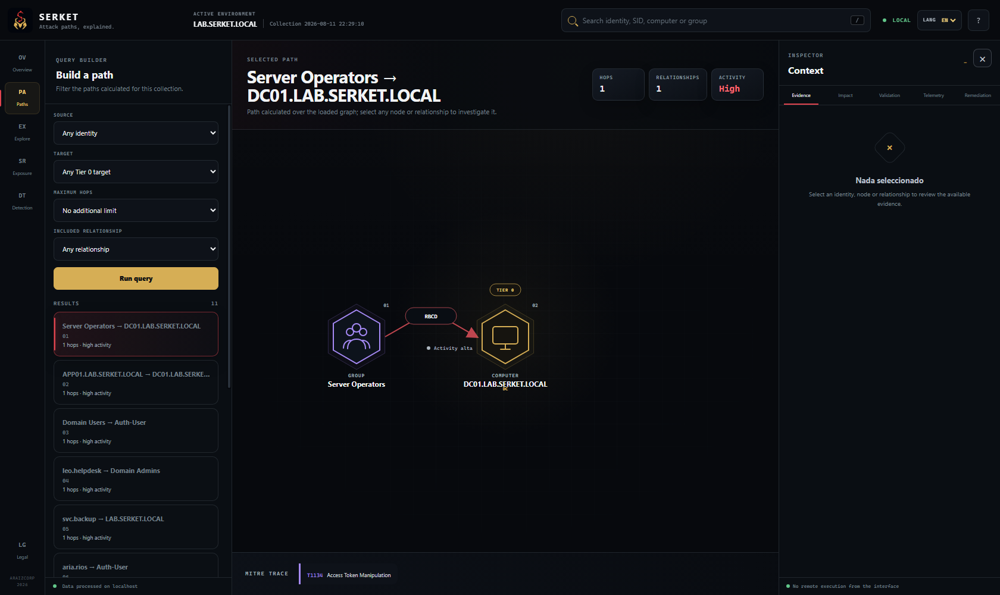
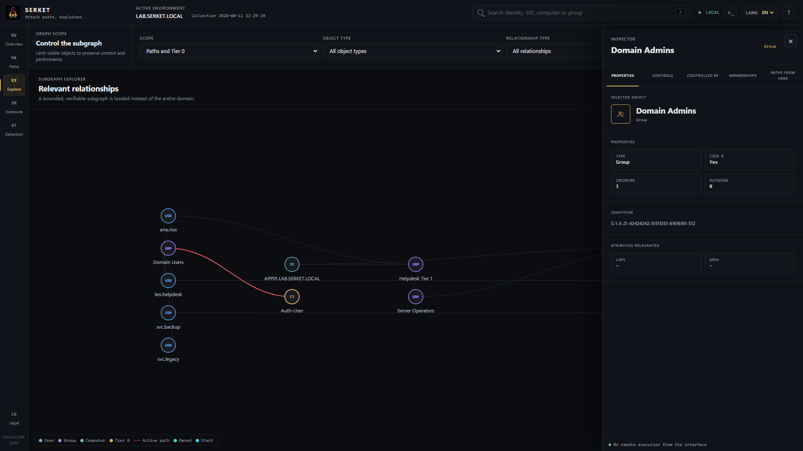
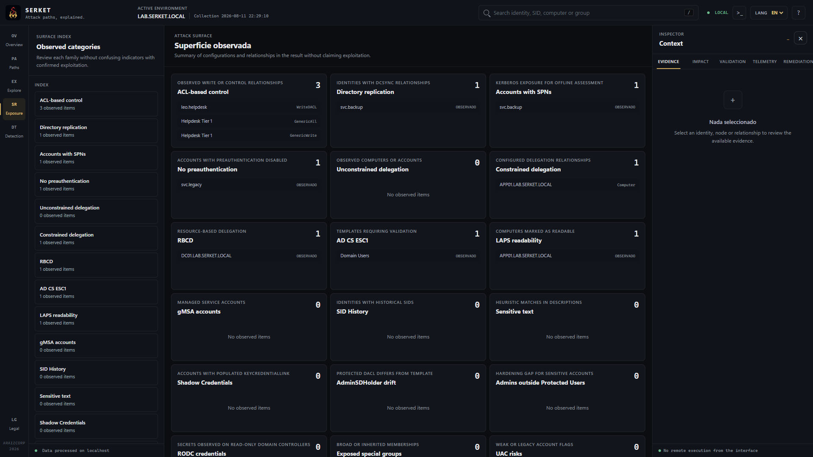
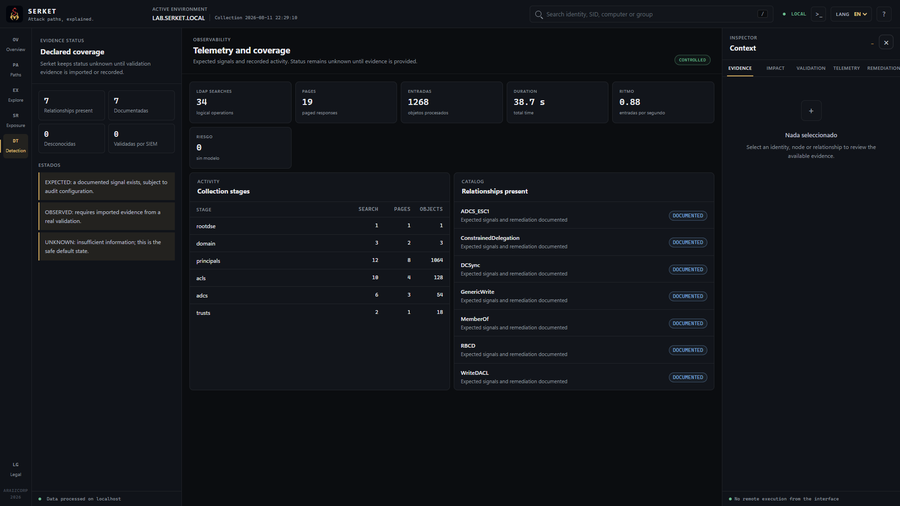
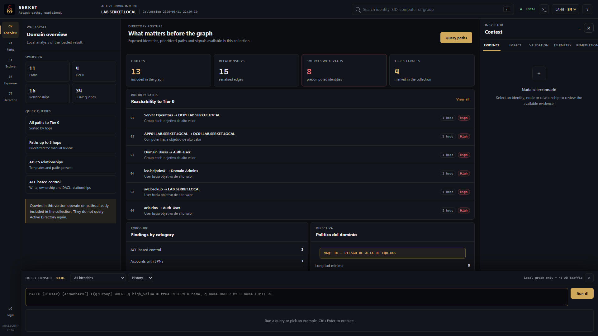
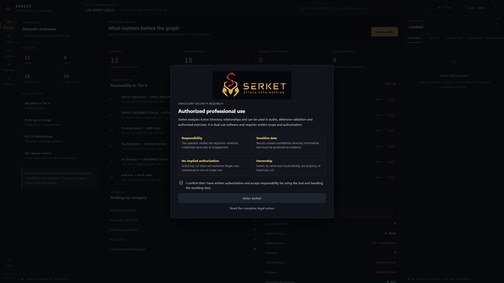
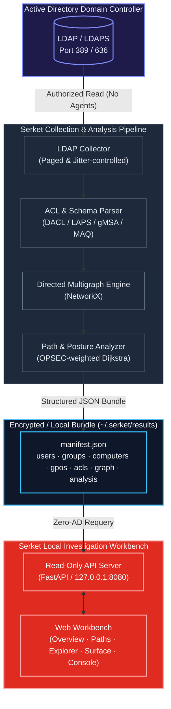

<p align="center">
  
</p>

<h1 align="center">Serket</h1>

<p align="center">
  Active Directory relationship intelligence and attack-path analysis.<br>
  A local-first, dual-use security tool by <strong>AraizCorp LLC</strong>.
</p>

<p align="center">
  <a href="https://github.com/araizcorp/Serket/releases/tag/v2.1.0"></a>
  
  
  
  
  <a href="LICENSE"></a>
</p>

<p align="center">
  <a href="README.md">English</a> · <a href="README.es.md">Español</a> ·
  <a href="LEGAL.md">Legal notice</a> · <a href="DOCKER.md">Container guide</a> ·
  <a href="https://github.com/araizcorp/Serket/releases/tag/v2.1.0"><strong>Download serket.exe (v2.1.0)</strong></a>
</p>

> [!WARNING]
> **Development status:** Serket is an active pre-release project. Core collection, graph construction, saved-result analysis, universal search and interactive path exploration work, but coverage is not yet complete. Do not treat the current output as an exhaustive assessment or use it as the sole basis for a production security decision.

> [!TIP]
> **Standalone Windows Binary Available:** You can download the pre-compiled `serket.exe` directly from [Release v2.1.0](https://github.com/araizcorp/Serket/releases/tag/v2.1.0) with zero Python prerequisites or virtual environment configuration required.

Serket collects authorized Active Directory metadata over LDAP, converts identities and permissions into a directed graph, and presents the result in an original investigation workbench. It is designed for defenders, auditors, red teams and purple teams working under an explicit authorization and rules of engagement.

Serket is not presented as “undetectable.” Its controlled collection profile reduces unnecessary queries, measures the collection footprint and helps an assessment team compare expected activity with DC, SIEM, EDR and NDR telemetry.

---

### Visual Workbench Interface



| Attack Paths (OPSEC-weighted) | Subgraph Explorer & Node Inspector |
|:---:|:---:|
|  |  |

| Observed Attack Surface | Telemetry & Coverage Engineering |
|:---:|:---:|
|  |  |

| In-Browser SKQL Query Console | Authorization Gate |
|:---:|:---:|
|  |  |

> Screenshots captured from the live Serket v2.1 Workbench serving the included `demo/` bundle.

---

## Current capabilities

| Capability | Status | Notes |
|:---|:---:|:---|
| **LDAP/DC-only collection** |  | Users, groups, systems, domain policy, OU/container hierarchy, GPOs, trusts, owner+DACL permissions and AD CS data |
| **Optional offline SYSVOL** |  | Explicit local/mounted copy only: Registry.pol, script inventory and Local Users and Groups preferences |
| **System classification** |  | Workstations, member servers and domain controllers are modeled and counted separately |
| **Authentication** |  | Password prompt, NTLM hash, Kerberos cache and optional LDAPS |
| **Rate-limit jitter** |  | `--rate-limit` + `--jitter` randomize the LDAP paging cadence (±50% by default) |
| **Relationship graph** |  | Directed multigraph; parallel permissions are preserved instead of overwriting one another |
| **Global path analysis** |  | OPSEC-weighted Dijkstra paths to high-value nodes |
| **Interactive path query** |  | Choose a loaded source and target/Tier 0; computation uses the saved graph and does not query AD again |
| **Universal search** |  | Name, SID, UPN, DN, DNS name and `sAMAccountName` |
| **Node and relationship inspector** |  | Controls, controlled by, memberships, paths, evidence, impact and remediation context |
| **Local web workbench** |  | Overview, Paths, Explorer, Exposure and Detection views; English default, Spanish optional |
| **Docker packaging** |  | Hardened image, Compose file and multi-architecture GHCR workflow are included |
| **AD CS classification** |  | Automated ESC1 classification only |
| **Trust analysis** |  | Trust objects are enumerated; advanced abuse conclusions are not inferred yet |
| **Detection validation** |  | Guidance and expected telemetry are shown; live SIEM/EDR evidence import is not implemented yet |
| **Collection bundle** |  | Manifest plus separate JSON files for identities, systems, permissions, directory structure, AD CS, graph and analysis |

---

## Architecture & How It Works



The browser interface reads the saved result. It never executes validation commands and an interactive path query never reconnects to the directory.

---

## Controlled collection (OPSEC)

Serket is designed for authorized red team and purple team work where the collection itself must stay low-profile:

- **LDAP-only, DC-only, single session.** No SMB, no Kerberos roasting, no port scanning. The only traffic is standard paged LDAP search against one domain controller.
- **Rate-limited paging with random jitter.** `--rate-limit SEC` (default `0.08`) sleeps between pages; `--jitter 0-1` (default `0.5`) randomizes each pause by ±50% so the cadence does not look like a regular script. Raise both for a quieter profile (e.g. `--rate-limit 0.4 --jitter 0.7`).
- **LDAPS** (`--ldaps`) encrypts queries in transit on port 636.
- **Footprint measurement.** Every run records the searches, pages and entries it generated (`collection.telemetry` in the manifest) so the team can compare expected activity with DC, SIEM, EDR and NDR telemetry during a purple-team review.

Serket does not claim to be undetectable: with LDAP query auditing enabled, any LDAP client is observable. The goal is a controlled, measurable profile, not invisibility.

---

## Requirements

- Python 3.10 or later
- Network access from the collector host to the authorized domain controller
- A domain account with enough read access for the selected collection scope
- Docker or Podman only if the container workflow is used

> [!NOTE]
> ACL, LAPS, gMSA and AD CS visibility depends on the permissions granted to the assessment account and on the configuration of the target environment.

---

## Try the synthetic demo

The included demo contains fictional `LAB.SERKET.LOCAL` identities and does not contact a domain controller.

### Windows PowerShell

```powershell
py -m venv .venv
.\.venv\Scripts\Activate.ps1
python -m pip install .
serket --serve demo/serket-demo.json
```

### Linux or macOS

```bash
python3 -m venv .venv
source .venv/bin/activate
python -m pip install .
serket --serve demo/serket-demo.json
```

Open <http://127.0.0.1:8080>. Native mode binds only to loopback and normally opens the default browser automatically.

---

## Install for native collection

Serket requires Python 3.10 or later. The installation creates the `serket` command; do not run the tool with `python serket.py` after installing it.

### Kali Linux, Linux and macOS

```bash
git clone https://github.com/araizcorp/Serket.git
cd Serket
python3 -m venv .venv
source .venv/bin/activate
python -m pip install --upgrade pip
python -m pip install .
hash -r
serket --help
```

On Kali or any other Linux distribution, **do not use `py -m pip install .`**. `py` is the Windows Python launcher and may be an unrelated command on Linux. Once the virtual environment is active, use `python -m pip install .` as shown above.

The `serket` command works from any directory while the virtual environment is active. To use it in a later terminal, activate the same environment again:

```bash
source /path/to/Serket/.venv/bin/activate
serket --help
```

<details>
<summary><strong>Alternative: Global pipx installation</strong></summary>

If `pipx` is already installed and you want `serket` on your user `PATH` without activating a virtual environment each time, run this from the cloned repository:

```bash
pipx install .
pipx ensurepath
```

Open a new terminal after `pipx ensurepath`, then verify the command with `serket --help`.
</details>

### Windows PowerShell

```powershell
git clone https://github.com/araizcorp/Serket.git
Set-Location Serket
py -m venv .venv
.\.venv\Scripts\Activate.ps1
python -m pip install --upgrade pip
python -m pip install .
serket --help
```

`py` is used only to create the environment on Windows. If the launcher is unavailable, replace that first `py` with `python`. After activation, use `python -m pip` so the package and the `serket` command are installed in the active environment.

---

## Collect an authorized domain

### Password authentication

Omit `-p` to enter the password through the hidden prompt instead of storing it in shell history:

```bash
serket \
  -d corp.local \
  -u auditor \
  --ldaps
```

Serket discovers a domain controller automatically through the Active Directory DNS SRV records for the supplied domain. Use `-dc HOST` only to override discovery, select a specific controller or work around unavailable AD DNS.

### Kerberos authentication

```bash
export KRB5CCNAME=/tmp/auditor.ccache
serket -d corp.local -u auditor -k
```

PowerShell equivalent:

```powershell
$env:KRB5CCNAME = "C:\path\to\auditor.ccache"
serket -d corp.local -u auditor -k
```

### NTLM hash

```bash
serket \
  -d corp.local \
  -u auditor \
  --hashes :NT_HASH
```

> [!IMPORTANT]
> Only use credential material that is explicitly covered by the authorization for the assessment. Prefer LDAPS when the environment supports it.

<details>
<summary><strong>Advanced: Optional offline SYSVOL evidence</strong></summary>

Supply an explicitly authorized local or mounted SYSVOL copy to confirm GPO content without changing the default LDAP-only boundary:

```bash
serket -d corp.local -u auditor -k --sysvol-root /evidence/SYSVOL
```

Serket does not discover or mount a share for this option. Registry policy parsing is bounded, script contents are represented only by hashes, and GPP `cpassword` values are never retained. Without `--sysvol-root`, SYSVOL remains `not_assessed` rather than being inferred safe.
</details>

<details>
<summary><strong>Advanced: Optional Portico external-surface integration</strong></summary>

Portico remains a separate application so an internet-facing assessment node does not need LDAP access and the Serket host does not need outbound internet access. Import a transferred, sanitized bridge into an existing package:

```bash
serket external-enrich --input assessment.serket \
  --bridge portico-bridge.json --output assessment-external.serket
```

For an explicitly authorized combined run, install the standalone `portico` executable in `PATH` and opt in:

```bash
serket -d corp.local -u auditor -k --include-external-surface
```

This convenience mode invokes `portico scan` and `portico export` as separate processes, consumes only the secret-free bridge, and omits external collection without failing if Portico is unavailable. Serket does not import Portico's HTTP, DNS, or TLS scanner code, and never performs external probing by default.
</details>

---

### Collection controls

```bash
serket \
  -d corp.local \
  -u auditor \
  --rate-limit 0.20 \
  --max-paths 50 \
  --no-adcs
```

| Flag / Option | Type | Default | Description |
|:---|:---:|:---:|:---|
| `-dc HOST` | `string` | Auto-SRV | Override automatic AD DNS discovery and use a specific controller |
| `--rate-limit SEC` | `float` | `0.08` | Delay between LDAP result pages in seconds |
| `--jitter FLOAT` | `float` | `0.50` | Random variance percentage applied to rate-limit sleep cadence (±50%) |
| `--max-paths N` | `int` | `20` | Maximum global attack paths precomputed and saved |
| `--no-acls` | `flag` | `False` | Skip owner and DACL collection; faster but removes permission edges |
| `--no-adcs` | `flag` | `False` | Skip certificate template and enrollment hierarchy enumeration |
| `--include-external-surface` | `flag` | `False` | Explicitly invoke standalone Portico and consume its sanitized bridge |
| `--ldaps` | `flag` | `False` | Enforce LDAP over TLS on port 636 |
| `-o DIR` | `path` | `~/.serket/` | Target directory for generated result bundle |
| `--quiet` | `flag` | `False` | Suppress interactive CLI progress bars for automated pipelines |

ACL and ADCS descriptor queries automatically request the owner and DACL through the Microsoft LDAP security-descriptor control. No additional flag or dependency is required. `--no-acls` and `--no-adcs` are applied to the collection pipeline; they are not display-only switches.

### Collection coverage: LDAP/DC-only versus host data

The standard Serket run is an LDAP/DC-only collection. It covers the directory-structure portion expected from a BloodHound-style collector: object properties, security-group memberships, trusts, OU/container structure, GPO links, relevant owner/DACL permissions on users, groups, systems, GPOs, OUs, containers and the domain, plus the currently supported AD CS objects.

It does **not** contact every domain-joined host. Consequently, a standard run does not claim host-derived relationships such as `HasSession`, local `AdminTo`, `CanRDP`, `ExecuteDCOM`, `CanPSRemote` or `SQLAdmin`. Those require SMB/RPC, registry or host telemetry and a different authorization/noise profile. Every result records this distinction under `coverage` so an absent relationship is not presented as evidence that it does not exist. This follows the directory/DC-only versus computer-collection distinction in the [SharpHound collection methods](https://bloodhound.specterops.io/collect-data/ce-collection/sharphound-flags).

---

## Results & Bundle Structure

By default Serket writes one collection directory below `~/.serket/results/`:

```text
serket_corp_local_YYYYMMDD_HHMMSS/
├── manifest.json
├── domain.json
├── users.json
├── groups.json
├── computers.json
├── directory_objects.json
├── gpos.json
├── trusts.json
├── permissions.json
├── adcs.json
├── summary.json
├── graph.json
├── analysis.json
└── report.txt
```

`manifest.json` declares the bundle schema and component files. Splitting object families makes incomplete or unexpectedly empty collection stages visible and lets the loader validate the package before composing one logical result. The graph and path engine still operate over the unified in-memory dataset. Treat the entire directory as sensitive assessment evidence even when it does not contain passwords; do not move only some component files.

`serket server`, `--load` and `--serve` accept either the collection directory or its `manifest.json`. Legacy single-file Serket JSON remains readable.

Results produced by the affected early v2.0 collector, where binary SID bytes were serialized as unreadable text, are repaired in memory when loaded. This restores canonical identity IDs, workstation/server/DC classification, Tier-0 marking and membership-derived paths. It cannot restore ACL relationships that were never written to the old file; run a fresh collection for complete owner/DACL coverage.

---

### Open the latest result in the Workbench

After a collection finishes, start the web interface without locating the bundle manually:

```bash
serket server
```

This opens the newest result in `~/.serket/results/`. To select the newest result for a particular domain:

```bash
serket server -d corp.local
```

Use `--port 9090` to select another local port or `--output DIR` if the collection was saved outside the default directory. The Workbench listens only on `127.0.0.1`.

### Read a saved result in the terminal

```bash
serket --load ~/.serket/results/serket_corp_local_YYYYMMDD_HHMMSS
```

### Open a specific collection bundle in the Workbench

```bash
serket \
  --serve ~/.serket/results/serket_corp_local_YYYYMMDD_HHMMSS \
  --port 8080
```

---

## Using the Workbench

1. **Overview** shows domain, graph and collection metrics, separate workstation/server/DC counts, data quality and the highest-priority calculated paths.
2. **Search** accepts a partial name, SID, UPN, distinguished name, DNS name or `sAMAccountName`.
3. **Paths** lets you select a source identity and a destination or all Tier 0 targets, filter the relationship type and constrain hop count.
4. **Focused graph** displays the selected route as an interactive directed subgraph. Drag the diamond nodes to rearrange it; curves, arrows and labels follow automatically.
5. **Inspector** opens when a node or edge is selected. Node tabs show controls, incoming control, memberships and saved paths. Relationship tabs show evidence, impact, validation, telemetry and remediation guidance.
6. **Explorer** supports progressive manual navigation. Selecting an object makes it the only focus and shows its direct outgoing relationships; selecting any displayed destination moves the focus forward. The Back control restores the previous focus, and the scope selector can switch to incoming or bidirectional relationships.
7. **Explorer layout** keeps the scope controls in a compact horizontal bar above the graph. Object and relationship details are prepared in the background and open only with **Details** as a wider floating Inspector, so opening or closing it never resizes the graph.
8. **Exposure** groups Kerberos, delegation, ACL, AD CS, SID history, LAPS, gMSA and trust observations.
9. **Detection** distinguishes documented expectations from unknown validation state. “Unknown” means that no detection evidence was imported; it does not mean the activity is invisible.

Use the `EN / ES` selector to change language. The interface stores only the language preference in the browser.

---

## Local API Reference

The Workbench is powered by a local, read-only API designed for fast interactive inspection and local scripting:

| Method | Endpoint | Description |
|:---:|:---|:---|
|  | `/api/search?q=query` | Universal node search by name, SID, UPN, DN, or sAMAccountName |
|  | `/api/nodes/{node_id}` | Detailed node properties and directional relationships |
|  | `/api/graph` | Normalized graph schema and multigraph elements |
|  | `/api/stats` | Graph, system-role counts, and data-quality metrics |
|  | `/api/coverage` | Collected directory scope vs. host telemetry gaps |
|  | `/api/paths` | Precomputed global Tier 0 attack paths |
|  | `/api/query-paths` | On-demand path calculation over loaded graph (zero AD requery) |
|  | `/api/surface` | Derived exposure summary (Kerberos, AD CS, ACLs, LAPS, gMSA) |
|  | `/healthz` | Local API health and readiness check |

Example query body:

```json
{
  "source": "S-1-5-21-...-1101",
  "target": "tier0",
  "max_hops": 6,
  "include_edge": "all",
  "limit": 25
}
```

The response explicitly reports `"queried_directory": false` because the calculation uses only the graph already loaded in memory.

---

## Relationship and exposure coverage

Current graph construction includes, where supported by collected evidence:

- Direct and transitive `MemberOf` relationships
- `Contains`, `GPLink` and derived administrative control of domain controllers
- `GenericAll`, `GenericWrite`, `WriteDACL`, `WriteOwner` and `AllExtendedRights`
- `Owns`, `ForceChangePassword`, `AddMember` and `AddSelf`
- `AddKeyCredentialLink`, `AddAllowedToAct`, `WriteSPN` and `WriteAccountRestrictions`
- `GetChanges`, `GetChangesAll`, `GetChangesInFilteredSet` and derived `DCSync` when the required pair is present
- Unconstrained delegation, constrained delegation and RBCD
- Kerberoastable and AS-REP roastable identities
- AD CS ESC1 enrollment paths
- SID history and heuristic password-in-description indicators
- Legacy Microsoft LAPS and modern Windows LAPS visibility indicators
- gMSA readability indicators without persisting the managed-password blob
- Domain trusts and selected GPO metadata

Serket preserves multiple permissions between the same source and target. Non-traversable evidence such as an isolated replication right or ordinary certificate enrollment remains visible in the permission inventory but is excluded from pathfinding until the conditions for a traversable relationship are met.

These are relationship and exposure observations, not proof that an exploitation action occurred or will succeed. Validate every path in the target environment and within the agreed rules of engagement.

---

## Docker

### Build the current source locally

```bash
docker build --tag serket:dev .
docker run --rm \
  --read-only \
  --tmpfs /tmp:rw,noexec,nosuid,size=64m \
  --cap-drop ALL \
  --security-opt no-new-privileges \
  -p 127.0.0.1:8080:8080 \
  serket:dev
```

### Compose

```bash
docker compose up --build
```

### Published image

The release workflow is prepared for `ghcr.io/araizcorp/serket`, but this project is still under development. The public pull command becomes valid after the first tagged image is published:

```bash
docker pull ghcr.io/araizcorp/serket:latest
```

See [DOCKER.md](DOCKER.md) for read-only result mounts, Compose usage and publication details.

---

## Security and privacy model

- Native serving binds to `127.0.0.1`; documented container publishing also uses host loopback.
- The frontend has no CDN, Neo4j or external analytics dependency.
- Result data is not transmitted to AraizCorp or another service by the application.
- The API disables caching and adds restrictive browser security headers.
- The Workbench is read-only and never executes a suggested validation command.
- The collector records query/page/entry and stage telemetry for later review.

Serket does not replace authorization, a collection plan or change control. Store result files as sensitive client evidence and remove them according to the engagement retention policy.

---

## Known limitations and roadmap

The following items are not complete in this release:

- Host-derived session and local-right collection (`HasSession`, local `AdminTo`, RDP, DCOM, PSRemote and SQL admin); the current collector intentionally remains LDAP/DC-only
- ESC2–ESC8 automated AD CS analysis
- Advanced trust conclusions such as SID-filtering and quarantine abuse analysis
- Live SIEM/EDR evidence import and verified detection status
- Resumable interrupted collection
- Portable, integrity-checked `.serket` assessment packages
- Large-domain performance validation and broader graph-query presets
- Web-based PDF, Markdown and CSV export hub

---

## Development and verification

```bash
python -B -m unittest discover -s tests -v
python -m py_compile serket.py serket/cli.py serket/server/api.py
node --check serket/ui/workbench.js
node --check serket/ui/path-graph-interactions.js
docker build --tag serket:dev .
```

The automated suite covers API security headers, graph normalization, raw binary SID and security-descriptor handling, DCSync post-processing, parallel permissions, system classification, paths to domain controllers, legacy-result recovery, internationalization, universal search, node relationship directions and arbitrary-source path queries.

---

## Project layout

```text
pyproject.toml             package metadata and `serket` console entry point
serket.py                  source-checkout compatibility wrapper
serket/cli.py              CLI and orchestration
serket/collector/          LDAP collection and ACL parsing
serket/graph/              graph construction and path analysis
serket/output/             persistence and terminal reporting
serket/server/             local read-only FastAPI application
serket/ui/                 Workbench, localization and brand assets
demo/                      synthetic evaluation dataset
tests/                     automated regression tests
.github/workflows/         test and GHCR publication workflow
```

---

## Responsible use, license and ownership

Use Serket only on systems you own or are explicitly authorized in writing to assess. The operator is responsible for scope, timing, rules of engagement, legal compliance and secure handling of results.

Copyright © 2026 **AraizCorp LLC**. Source code is provided under the [MIT License](LICENSE). The license does not grant rights to the Serket or AraizCorp names, logos or visual identity. Read the full [legal and responsibility notice](LEGAL.md) before use; a [Spanish translation](LEGAL.es.md) is also available.
