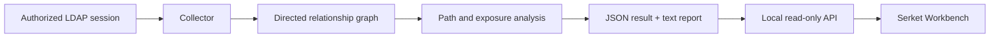

<p align="center">
  
</p>

<h1 align="center">Serket</h1>

<p align="center">
  Active Directory relationship intelligence and attack-path analysis.<br>
  A local-first, dual-use security tool by <strong>AraizCorp LLC</strong>.
</p>

<p align="center">
  <a href="README.md">English</a> · <a href="README.es.md">Español</a> ·
  <a href="LEGAL.md">Legal notice</a> · <a href="DOCKER.md">Container guide</a>
</p>

> [!WARNING]
> **Development status:** Serket is an active pre-release project. Core collection, graph construction, saved-result analysis, universal search and interactive path exploration work, but coverage is not yet complete. Do not treat the current output as an exhaustive assessment or use it as the sole basis for a production security decision.

Serket collects authorized Active Directory metadata over LDAP, converts identities and permissions into a directed graph, and presents the result in an original investigation workbench. It is designed for defenders, auditors, red teams and purple teams working under an explicit authorization and rules of engagement.

Serket is not presented as “undetectable.” Its controlled collection profile reduces unnecessary queries, measures the collection footprint and helps an assessment team compare expected activity with DC, SIEM, EDR and NDR telemetry.


## Current capabilities

| Capability | Status | Notes |
|---|---:|---|
| LDAP collection | Available | Users, groups, computers, domain policy, GPOs, trusts, selected ACLs and AD CS data |
| Authentication | Available | Password prompt, NTLM hash, Kerberos cache and optional LDAPS |
| Relationship graph | Available | Directed graph with transitive group membership and permission/delegation edges |
| Global path analysis | Available | OPSEC-weighted Dijkstra paths to high-value nodes |
| Interactive path query | Available | Choose a loaded source and target/Tier 0; computation uses the saved graph and does not query AD again |
| Universal search | Available | Name, SID, UPN, DN, DNS name and `sAMAccountName` |
| Node and relationship inspector | Available | Controls, controlled by, memberships, paths, evidence, impact and remediation context |
| Local web workbench | Available | Overview, Paths, Explorer, Exposure and Detection views; English default, Spanish optional |
| Docker packaging | Prepared | Hardened image, Compose file and multi-architecture GHCR workflow are included |
| AD CS classification | Partial | Automated ESC1 classification only |
| Trust analysis | Partial | Trust objects are enumerated; advanced abuse conclusions are not inferred yet |
| Detection validation | Partial | Guidance and expected telemetry are shown; live SIEM/EDR evidence import is not implemented yet |
| `.serket` portable package | Planned | Current result format is JSON plus a text report |

## How it works



The browser interface reads the saved result. It never executes validation commands and an interactive path query never reconnects to the directory.

## Requirements

- Python 3.9 or later
- Network access from the collector host to the authorized domain controller
- A domain account with enough read access for the selected collection scope
- Docker or Podman only if the container workflow is used

ACL, LAPS, gMSA and AD CS visibility depends on the permissions granted to the assessment account and on the configuration of the target environment.

## Try the synthetic demo

The included demo contains fictional `LAB.SERKET.LOCAL` identities and does not contact a domain controller.

### Windows PowerShell

```powershell
py -m venv .venv
.\.venv\Scripts\Activate.ps1
python -m pip install -r requirements.txt
python serket.py --serve demo/serket-demo.json
```

### Linux or macOS

```bash
python3 -m venv .venv
source .venv/bin/activate
python -m pip install -r requirements.txt
python serket.py --serve demo/serket-demo.json
```

Open <http://127.0.0.1:8080>. Native mode binds only to loopback and normally opens the default browser automatically.

## Install for native collection

Clone the repository and install its Python dependencies inside a virtual environment:

```bash
git clone https://github.com/araizcorp/Serket.git
cd Serket
python3 -m venv .venv
source .venv/bin/activate
python -m pip install --upgrade pip
python -m pip install -r requirements.txt
```

On Linux, `./install.sh --venv` provides the same basic setup. On Windows use `py` or `python` and activate with `.\.venv\Scripts\Activate.ps1`.

## Collect an authorized domain

### Password authentication

Omit `-p` to enter the password through the hidden prompt instead of storing it in shell history:

```bash
python serket.py \
  -dc dc01.corp.local \
  -d corp.local \
  -u auditor \
  --ldaps
```

### Kerberos

```bash
export KRB5CCNAME=/tmp/auditor.ccache
python serket.py -dc dc01.corp.local -d corp.local -u auditor -k
```

PowerShell equivalent:

```powershell
$env:KRB5CCNAME = "C:\path\to\auditor.ccache"
python serket.py -dc dc01.corp.local -d corp.local -u auditor -k
```

### NTLM hash

```bash
python serket.py \
  -dc 10.10.10.10 \
  -d corp.local \
  -u auditor \
  --hashes :NT_HASH
```

Only use credential material that is explicitly covered by the authorization for the assessment. Prefer LDAPS when the environment supports it.

### Collection controls

```bash
python serket.py \
  -dc dc01.corp.local \
  -d corp.local \
  -u auditor \
  --rate-limit 0.20 \
  --max-paths 50 \
  --no-adcs
```

| Option | Purpose |
|---|---|
| `--rate-limit SEC` | Delay between LDAP result pages; default `0.08` seconds |
| `--max-paths N` | Maximum global paths saved; default `20` |
| `--no-acls` | Skip ACL collection; faster but removes important permission edges |
| `--no-adcs` | Skip certificate-template enumeration |
| `--ldaps` | Use LDAP over TLS on port 636 |
| `-o DIR` | Select the output directory |
| `--quiet` | Suppress progress output for machine-oriented execution |

Run `python serket.py --help` for the complete CLI reference.

## Results

By default Serket writes to `~/.serket/results/`:

```text
serket_corp_local_YYYYMMDD_HHMMSS.json
serket_corp_local_YYYYMMDD_HHMMSS_report.txt
```

The JSON contains metadata, collection telemetry, graph nodes and edges, derived exposure summaries and calculated paths. Treat it as sensitive assessment evidence even when it does not contain passwords.

### Read a saved result in the terminal

```bash
python serket.py --load ~/.serket/results/serket_corp_local_YYYYMMDD_HHMMSS.json
```

### Open a saved result in the Workbench

```bash
python serket.py \
  --serve ~/.serket/results/serket_corp_local_YYYYMMDD_HHMMSS.json \
  --port 8080
```

## Using the Workbench

1. **Overview** shows domain, graph and collection metrics plus the highest-priority calculated paths.
2. **Search** accepts a partial name, SID, UPN, distinguished name, DNS name or `sAMAccountName`.
3. **Paths** lets you select a source identity and a destination or all Tier 0 targets, filter the relationship type and constrain hop count.
4. **Focused graph** displays the selected route as an interactive directed subgraph. Drag the diamond nodes to rearrange it; curves, arrows and labels follow automatically.
5. **Inspector** opens when a node or edge is selected. Node tabs show controls, incoming control, memberships and saved paths. Relationship tabs show evidence, impact, validation, telemetry and remediation guidance.
6. **Explorer** presents a focused graph around the selected object instead of trying to render the entire directory at once.
7. **Exposure** groups Kerberos, delegation, ACL, AD CS, SID history, LAPS, gMSA and trust observations.
8. **Detection** distinguishes documented expectations from unknown validation state. “Unknown” means that no detection evidence was imported; it does not mean the activity is invisible.

Use the `EN / ES` selector to change language. The interface stores only the language preference in the browser.

## Local API

The Workbench uses a small read-only API that can also support local integrations:

| Method | Endpoint | Purpose |
|---|---|---|
| `GET` | `/api/search?q=aria` | Universal node search |
| `GET` | `/api/nodes/{node_id}` | Node details and relationship directions |
| `GET` | `/api/graph` | Normalized saved graph |
| `GET` | `/api/paths` | Precomputed global paths |
| `POST` | `/api/query-paths` | On-demand path calculation over the loaded graph |
| `GET` | `/api/surface` | Derived exposure summary |
| `GET` | `/healthz` | Local health check |

Example query body:

```json
{
  "source": "S-1-5-21-...-1101",
  "target": "tier0",
  "max_hops": 6,
  "include_edge": "all",
  "limit": 25
}
```

The response explicitly reports `"queried_directory": false` because the calculation uses only the graph already loaded in memory.

## Relationship and exposure coverage

Current graph construction includes, where supported by collected evidence:

- Direct and transitive `MemberOf` relationships
- `GenericAll`, `GenericWrite`, `WriteDACL`, `WriteOwner` and `AllExtendedRights`
- `ForceChangePassword`, `AddMember`, `AddSelf` and `ShadowCredentials`
- `DCSync`
- Unconstrained delegation, constrained delegation and RBCD
- Kerberoastable and AS-REP roastable identities
- AD CS ESC1 enrollment paths
- SID history and heuristic password-in-description indicators
- Legacy Microsoft LAPS and modern Windows LAPS visibility indicators
- gMSA readability indicators without persisting the managed-password blob
- Domain trusts and selected GPO metadata

These are relationship and exposure observations, not proof that an exploitation action occurred or will succeed. Validate every path in the target environment and within the agreed rules of engagement.

## Docker

### Build the current source locally

```bash
docker build --tag serket:dev .
docker run --rm \
  --read-only \
  --tmpfs /tmp:rw,noexec,nosuid,size=64m \
  --cap-drop ALL \
  --security-opt no-new-privileges \
  -p 127.0.0.1:8080:8080 \
  serket:dev
```

### Compose

```bash
docker compose up --build
```

### Published image

The release workflow is prepared for `ghcr.io/araizcorp/serket`, but this project is still under development. The public pull command becomes valid after the first tagged image is published:

```bash
docker pull ghcr.io/araizcorp/serket:latest
```

See [DOCKER.md](DOCKER.md) for read-only result mounts, Compose usage and publication details.

## Security and privacy model

- Native serving binds to `127.0.0.1`; documented container publishing also uses host loopback.
- The frontend has no CDN, Neo4j or external analytics dependency.
- Result data is not transmitted to AraizCorp or another service by the application.
- The API disables caching and adds restrictive browser security headers.
- The Workbench is read-only and never executes a suggested validation command.
- The collector records query/page/entry and stage telemetry for later review.

Serket does not replace authorization, a collection plan or change control. Store result files as sensitive client evidence and remove them according to the engagement retention policy.

## Known limitations and roadmap

The following items are not complete in this release:

- ESC2–ESC8 automated AD CS analysis
- Advanced trust conclusions such as SID-filtering and quarantine abuse analysis
- Live SIEM/EDR evidence import and verified detection status
- Resumable interrupted collection
- Portable, integrity-checked `.serket` assessment packages
- Large-domain performance validation and broader graph-query presets
- Web-based PDF, Markdown and CSV export hub

Roadmap items are not security claims. Track implementation and tests in repository releases and issues.

## Development and verification

```bash
python -B -m unittest discover -s tests -v
python -m py_compile serket.py serket/server/api.py
node --check serket/ui/workbench.js
docker build --tag serket:dev .
```

The current automated suite covers API security headers, graph normalization, collection invariants, internationalization, universal search, node relationship directions and arbitrary-source path queries. A successful unit test run does not replace validation against an authorized lab domain.

## Project layout

```text
serket.py                  CLI and orchestration
serket/collector/          LDAP collection and ACL parsing
serket/graph/              graph construction and path analysis
serket/output/             persistence and terminal reporting
serket/server/             local read-only FastAPI application
serket/ui/                 Workbench, localization and brand assets
demo/                      synthetic evaluation dataset
tests/                     automated regression tests
.github/workflows/         test and GHCR publication workflow
```

## Responsible use, license and ownership

Use Serket only on systems you own or are explicitly authorized in writing to assess. The operator is responsible for scope, timing, rules of engagement, legal compliance and secure handling of results.

Copyright © 2026 **AraizCorp LLC**. Source code is provided under the [MIT License](LICENSE). The license does not grant rights to the Serket or AraizCorp names, logos or visual identity. Read the full [legal and responsibility notice](LEGAL.md) before use; a [Spanish translation](LEGAL.es.md) is also available.
